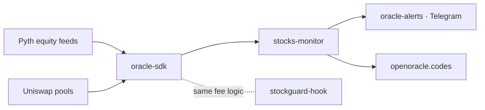

  

  
  
  
  

### Tokenized stocks trade 24/7. Stock markets don't.

Open Oracle builds open-source tools that keep tokenized-stock markets on Ethereum honest: real reference prices, market hours, and a Uniswap v4 hook that checks every swap.

| | Repository | What it does |
|---|---|---|
| 🛡️ | [**stockguard-hook**](https://github.com/openoracle-evm/stockguard-hook) | Uniswap v4 hook: market hours, oracle freshness, deviation guard, KYC allowlist. Solidity · Foundry |
| 📦 | [**oracle-sdk**](https://github.com/openoracle-evm/oracle-sdk) | Pyth equity prices, NYSE hours with holidays, Uniswap pool prices, premium in bps. TypeScript |
| 📡 | [**stocks-monitor**](https://github.com/openoracle-evm/stocks-monitor) | Tracks tokenized stocks vs. their real price. HTTP + Server-Sent Events API, Docker |
| 🔔 | [**oracle-alerts**](https://github.com/openoracle-evm/oracle-alerts) | Telegram bot: alerts when a token drifts from its real price, market open/close |

**Try it:** open the [StockGuard simulator](https://openoracle.codes/#stocks), close the market, shock the price and watch the hook react.

The smart contract is not yet audited. Nothing here is financial advice.
